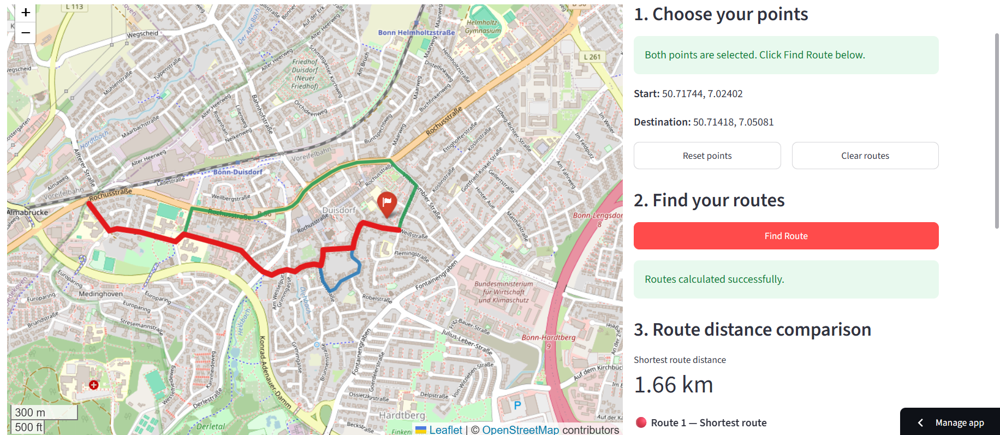

# Bonn Interactive Alternative Route Finder

An interactive GIS web application for exploring driving routes in Bonn, Germany. Users can select an origin and destination directly on an interactive map, calculate the shortest-distance driving route, and compare alternative routes.


## Overview

Finding alternative routes between locations is a useful application of GIS network analysis. This project combines OpenStreetMap road network data with graph-based pathfinding algorithms to identify and compare possible driving routes.

The application provides a simple, interactive interface for exploring road connectivity and route alternatives without requiring users to run GIS software locally.
## Application Preview

Explore alternative driving routes interactively in Bonn, Germany.



**[Launch the Live Application](https://gis-remote-sensing-portfolio-husfpsxfrr6klhchenfr2z.streamlit.app/)**


## Features

- **Interactive map:** Select locations directly on the map.
- **Origin and destination selection:** Choose two locations in Bonn to define a journey.
- **Shortest-distance routing:** Calculate a route based on road-network distance.
- **Alternative routes:** Explore up to two additional route options when suitable alternatives are available.
- **Route comparison:** Compare route distances and detours relative to the shortest route.
- **Web-based interface:** Access the application through a browser without installing Python or GIS software.

## Technologies Used

| Technology | Purpose |
|---|---|
| Python | Application logic and geospatial processing |
| Streamlit | Interactive web application |
| Folium | Interactive map visualization |
| OpenStreetMap | Road network data |
| OSMnx | Road network retrieval and processing |
| NetworkX | Graph-based shortest-path and alternative-route calculations |
| scikit-learn | Dependency for nearest-node searches on an unprojected network |

## How to Use the Application

1. Open the [live route finder](https://gis-remote-sensing-portfolio-husfpsxfrr6klhchenfr2z.streamlit.app/).
2. Click a location on the map to select the origin.
3. Click a second location to select the destination.
4. Allow the application to calculate the available routes.
5. Review the displayed routes and compare their distances.
6. Select a new pair of locations to explore another journey.

The availability of alternative routes depends on the road network and the application's route-selection criteria.

## Methodology

The application represents the road network as a graph, where road intersections and connected road locations are represented by nodes and road segments by edges.

Road network data for Bonn are retrieved from OpenStreetMap using OSMnx. NetworkX is then used to identify the shortest-distance path and search for suitable alternative paths.

Route alternatives are filtered to avoid options that are excessively longer than the shortest route or that overlap too heavily with it.

The route calculations are based on road-network distance rather than estimated travel time.

## Run Locally

To run the application on your own computer, first install Python and clone this repository:

```bash
git clone https://github.com/Kissi77/gis-remote-sensing-portfolio.git
cd gis-remote-sensing-portfolio
```

Install the dependencies:

```bash
pip install -r bonn-alternative-route-finder/requirements.txt
```

Start the application:

```bash
streamlit run bonn-alternative-route-finder/app.py
```

Replace `YOUR-USERNAME` with your GitHub username.

The first run may take some time because the application needs to retrieve and process the road network data.

## Project Structure

```text
bonn-alternative-route-finder/
├── app.py
├── requirements.txt
└── README.md
```

## Limitations

- Routes are optimized for distance, not travel time.
- Live traffic conditions and temporary road closures are not incorporated.
- Route availability and quality depend on OpenStreetMap road network coverage.
- Alternative routes may not always be available for every origin–destination pair.
- The application currently focuses on the Bonn, Germany, road network.

## Potential Future Improvements

- Add travel-time-based route optimization.
- Introduce route preferences, such as avoiding motorways or toll roads where data support them.
- Add origin and destination search by address or place name.
- Improve route comparison with additional network metrics.
- Expand the application to other cities.

## Data Source and Acknowledgement

Road network data are provided by [OpenStreetMap](https://www.openstreetmap.org/). © OpenStreetMap contributors.

