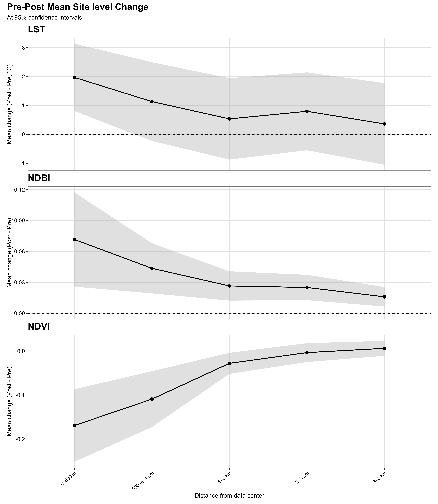

# Multisite Satellite Analysis of Data-Centre Developments in Malaysia

## Project Overview

This project investigates spatial patterns in land-surface temperature, vegetation, and built-up surfaces around multiple data-centre developments in Malaysia using satellite remote sensing and geospatial analysis.

The research examines how environmental indicators vary with distance from development sites and compares selected pre-development and post-development observations. Conventional urban and planned eco-city locations provide additional descriptive context.

## Research Objectives

- Assess land-surface temperature (LST), vegetation patterns (NDVI), and built-up surface patterns (NDBI) around data-centre developments in Malaysia.
- Examine environmental indicator changes across distance bands around 21 individual data-centre sites.
- Evaluate an alternative spatial approach that groups nearby data centres into four clusters while retaining nine standalone sites.
- Compare pre-development and post-development environmental indicators under both spatial approaches.
- Apply Before–After–Control–Impact (BACI) analysis to eligible clusters and standalone sites using matched controls.
- Examine how spatial grouping influences the interpretation of observed environmental changes.

## Spatial Analysis Framework

### Approach 1: Individual Analysis of 21 Data-Centre Sites

The first approach treats the 21 data-centre sites individually. Environmental indicators are summarised across distance bands to examine spatial patterns and pre-development/post-development changes in land-surface temperature, vegetation, and built-up surface characteristics.

This approach provides a multisite assessment of variation among individual data-centre locations and their surrounding areas.

#### Annual Trajectories

The annual dry-season trajectories provide a temporal overview of land-surface temperature (LST), vegetation (NDVI), and built-up surface patterns (NDBI) across the 21 individual data-centre sites.

#### Pre–Post Changes Across Five Distance Rings

This analysis examines pre-development and post-development changes in LST, NDVI, and NDBI across five distance rings around the individual data-centre sites: 0–500 m, 500 m–1 km, 1–2 km, 2–3 km, and 3–5 km.

*Interpretation note: These results describe observed changes across distance rings. They do not independently establish that data-centre development caused the changes.*

### Approach 2: Cluster-Based and Standalone-Site Analysis

The second approach groups nearby data centres into four clusters and analyses nine additional data centres as standalone sites. This spatial arrangement accounts for the proximity of neighbouring developments and the potential overlap of their surrounding areas.

Pre-development/post-development changes are assessed for the clusters and standalone sites. BACI analysis is also conducted for eligible units using matched control locations, allowing changes at impact units to be compared with changes in their controls.

### Distance-Band Design and Cluster Coverage

The individual-site analysis used five distance bands: 0–500 m, 500 m–1 km, 1–2 km, 2–3 km, and 3–5 km. These bands were used to examine how environmental indicators varied with distance from each of the 21 data-centre sites.

For the cluster-based analysis, nearby data centres were first grouped using overlapping 500 m buffers, which were dissolved to represent each cluster. A centroid was then calculated for each dissolved cluster. During spatial validation, some data centres were found to lie outside a 500 m buffer around their cluster centroid. The innermost cluster-analysis buffer was therefore increased to 1 km to ensure that all data centres belonging to each cluster were encompassed.

The cluster-based analysis used four distance bands: 0–1 km, 1–2 km, 2–3 km, and 3–5 km. This configuration was adopted to improve spatial coverage of the clustered developments while maintaining a consistent distance-band framework across the cluster-based units.

Because the two approaches use different spatial units and distance-band boundaries, their results are interpreted as complementary analyses rather than directly equivalent measurements at identical distances.

## Data and Tools

- **Satellite data:** Landsat imagery and Sentinel imagery where suitable observations are available.
- **Processing:** Google Earth Engine.
- **Programming and statistical analysis:** Python and R.
- **Geospatial analysis:** GIS, distance-based buffers, seasonal composites, and matched-control comparisons.

## Methodology

1. Prepare satellite observations and apply cloud and quality masking.
2. Generate seasonal image composites for the relevant study periods.
3. Derive land-surface temperature and calculate NDVI and NDBI where suitable imagery is available.
4. Conduct distance-band and pre–post analyses for the 21 individual data-centre sites.
5. Group nearby data centres into four clusters and retain nine standalone sites for the alternative spatial analysis.
6. Assess pre–post changes for the cluster-based and standalone-site units.
7. Conduct BACI comparisons for eligible impact units and matched controls.
8. Interpret results in light of observation availability, spatial dependence, environmental variability, and uncertainty in causal attribution.

## Results and Visualisations

### Annual Dry-Season Environmental Trajectories

The figure below presents annual dry-season trajectories for land-surface temperature (LST), the Normalized Difference Vegetation Index (NDVI), and the Normalized Difference Built-up Index (NDBI) across the study sites. Examining these indicators together helps characterise changes in surface thermal conditions, vegetation, and built-up surface patterns over the study period.

*Figure 1. Annual dry-season trajectories of LST, NDVI, and NDBI across the study sites in Malaysia. Interpretations should account for interannual climate variability, data availability, and differences in development timing.*

Additional figures will document pre–post changes across distance bands and comparisons between data-centre impact sites and matched controls.

Planned outputs include:

- Land-surface temperature comparisons.
- NDVI and NDBI change visualisations.
- Distance-band analysis.
- Pre-development and post-development comparisons.
- BACI estimates with confidence intervals.

## Limitations

Satellite observations can be limited by cloud cover, particularly in tropical environments. The number of eligible observations may therefore vary among sites and indicators. Changes observed after development should not automatically be attributed to data-centre development, because regional climate variability, rainfall, surrounding construction, and other land-use changes may also contribute.

## Research Contribution

The project demonstrates the application of satellite remote sensing, geospatial processing, spatial statistics, and matched-control methods to environmental monitoring around data-centre developments.

*This page describes the research workflow. Numerical findings and figures will be added once the selected outputs are verified and approved for sharing.*
