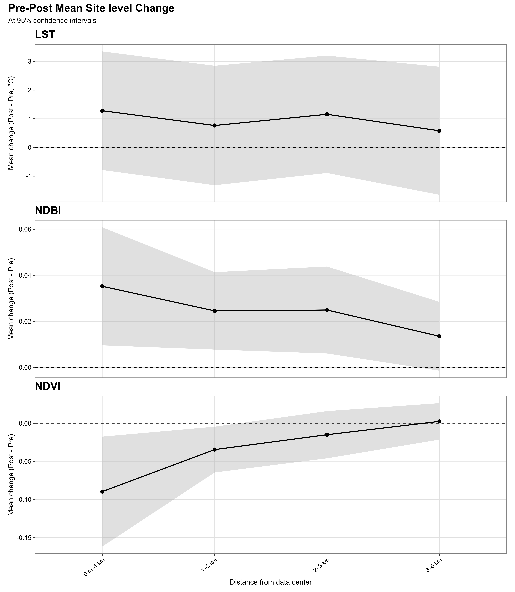
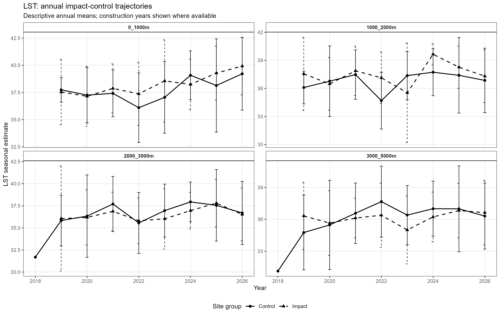
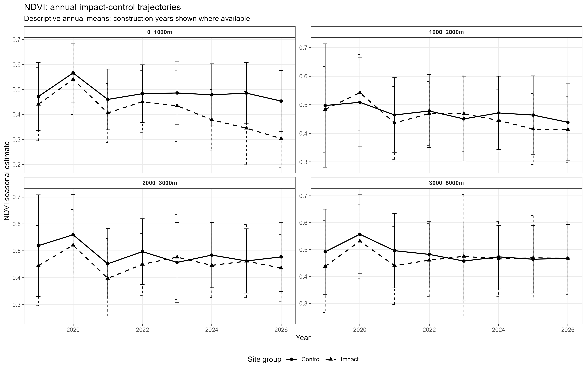
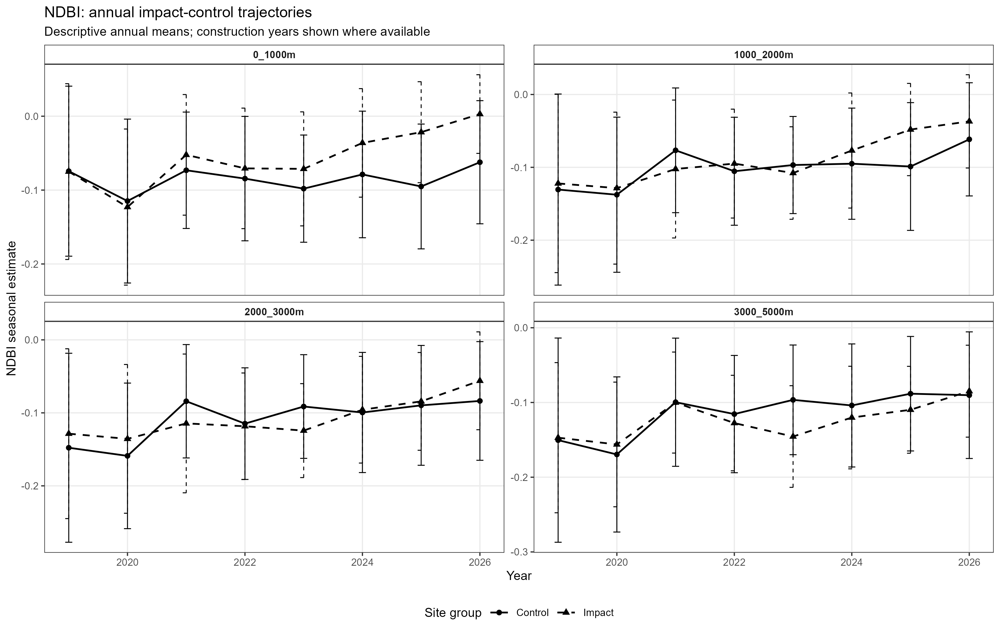
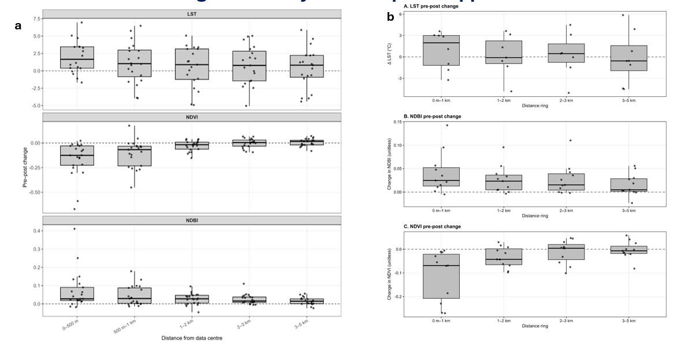
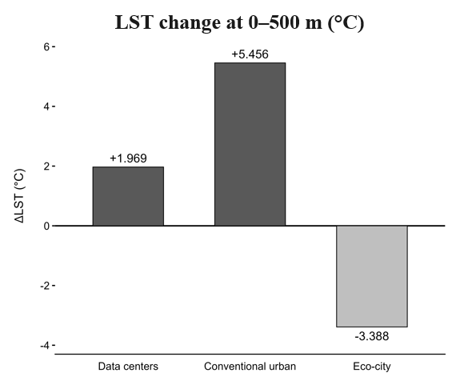
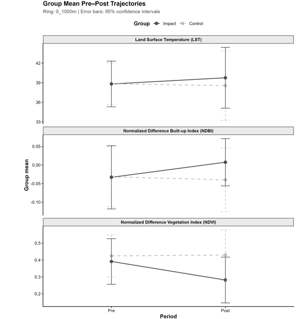

# Multisite Satellite Analysis of Data-Centre Developments in Malaysia

## Project Overview

This project uses Geographic Information Systems (GIS) and satellite remote sensing to examine land-surface temperature (LST), vegetation conditions, and built-up surface patterns around data-centre developments in Malaysia.

The analysis combines satellite-derived environmental indicators with spatial distance-band analysis, pre-development and post-development comparisons, and Before–After–Control–Impact (BACI) analysis using matched control locations where sufficient observations are available.

Two complementary spatial approaches are investigated:

1. **Individual-site analysis:** 21 data-centre sites assessed using five distance rings.
2. **Cluster-based and standalone-site analysis:** four clusters of nearby data centres and nine standalone sites assessed using four distance bands.

The project also examines environmental changes at conventional urban and planned eco-city reference sites and compares eligible impact units with matched controls. Findings are interpreted in the context of satellite observation availability, climate variability, spatial differences, and uncertainty in attributing observed changes to development.

## Research Objectives

- Examine LST, NDVI, and NDBI around data-centre developments in Malaysia.
- Assess environmental indicator patterns across distance rings around 21 individual data-centre sites.
- Compare pre-development and post-development environmental indicators.
- Evaluate a cluster-based approach that accounts for the proximity of neighbouring data centres.
- Compare observed LST changes at data-centre sites with changes at conventional urban and planned eco-city reference sites.
- Compare changes at eligible impact units with changes at matched controls using BACI analysis.
- Discuss methodological limitations and uncertainty in interpreting observed environmental changes.

## Environmental Indicators

- **Land Surface Temperature (LST):** Characterises the thermal conditions of the land surface.
- **Normalized Difference Vegetation Index (NDVI):** Indicates the presence and relative greenness of vegetation.
- **Normalized Difference Built-up Index (NDBI):** Helps characterise built-up surface patterns.

These indicators describe different aspects of the landscape. LST is not equivalent to near-surface air temperature, while NDVI and NDBI are spectral indicators rather than direct measurements of vegetation health or building density.

## Methodology

The workflow combines satellite-image processing, spatial analysis, and statistical comparisons.

1. Prepare satellite imagery for the relevant study periods.
2. Apply cloud and quality masking to reduce the influence of unsuitable observations.
3. Generate seasonal composites from available satellite observations.
4. Derive or compile LST, NDVI, and NDBI for suitable periods and locations.
5. Summarise environmental indicators across the specified distance rings or bands.
6. Compare eligible pre-development and post-development observations.
7. Group nearby data centres into clusters for a complementary spatial analysis.
8. Conduct BACI comparisons between eligible impact units and matched controls.
9. Interpret results alongside sample sizes, confidence intervals, and limitations in satellite data availability.

## 1. Individual-Site Analysis of 21 Data Centres

The first approach treats the 21 data-centre sites individually. Environmental indicators are summarised within five distance rings around each site:

- 0–500 m
- 500 m–1 km
- 1–2 km
- 2–3 km
- 3–5 km

This approach examines spatial variation in environmental indicators with distance from individual data-centre locations. Annual dry-season trajectories provide a temporal overview, while pre–post comparisons assess changes across the five rings.

### Annual Dry-Season Trajectories

The annual trajectories show how LST, NDVI, and NDBI vary over the study period across the individual-site analysis.

*Fig. 1. Annual dry-season trajectories of LST, NDVI, and NDBI across 21 individual data-centre sites.*

### Pre–Post Changes Across Five Distance Rings

This analysis compares pre-development and post-development environmental indicators across five distance rings around the individual data-centre sites.

*Fig. 2. Pre–post environmental changes across five distance rings around individual data-centre sites.*

## 2. Cluster-Based and Standalone-Site Analysis

The second approach accounts for the proximity of neighbouring data centres. Four groups of nearby data centres are analysed as clusters, while nine additional data centres are retained as standalone sites.

For each cluster, overlapping 500 m buffers were dissolved to represent the grouped developments, and a centroid was calculated from the dissolved geometry. Spatial validation showed that some data centres within a cluster fell outside a 500 m buffer around their cluster centroid. The innermost cluster-analysis buffer was therefore increased to 1 km to encompass all data centres belonging to each cluster.

The cluster-based analysis uses four distance bands:

- 0–1 km
- 1–2 km
- 2–3 km
- 3–4 km

These bands differ from the five rings used in the individual-site analysis. The individual-site approach measures distance from each data-centre location, whereas the cluster-based approach uses cluster centroids for grouped developments and individual locations for standalone sites. The two approaches are complementary rather than directly equivalent measurements at identical distances.

### Cluster-Based Annual Trajectories

The cluster-based annual trajectories provide a temporal overview of LST, NDVI, and NDBI across the four clusters and nine standalone sites.

*Fig. 3. Annual environmental indicator trajectories for the cluster-based and standalone-site analysis.*

### Pre–Post Changes Across Four Cluster-Based Distance Bands

This analysis compares pre-development and post-development environmental indicators across the four cluster-based distance bands.

*Fig. 4. Pre–post environmental changes across four distance bands in the cluster-based and standalone-site analysis.*

## 3. Before–After–Control–Impact Analysis

Before–After–Control–Impact (BACI) analysis compares changes over time at impact units with changes over the same period at matched control locations. This helps distinguish changes observed at impact locations from changes that may also occur at comparable locations.

The analysis is conducted for eligible clusters and standalone sites, subject to the availability of sufficiently valid satellite observations. Sample sizes may differ between LST, NDVI, and NDBI because observation availability and quality requirements can vary by indicator.

### LST: Impact Versus Matched Control

*Fig. 5. Land-surface temperature trajectories for impact units and matched control locations.*

### NDVI: Impact Versus Matched Control

*Fig. 6. Vegetation-index trajectories for impact units and matched control locations.*

### NDBI: Impact Versus Matched Control

*Fig. 7. Built-up surface index trajectories for impact units and matched control locations.*

### Pre–Post Environmental Variability Across the Two Spatial Approaches

This figure brings together the two spatial approaches to compare the variability in site-level pre–post changes across LST, NDVI, and NDBI.

*Fig. 8. Variability in site-level pre–post changes in LST, NDVI, and NDBI under two spatial analysis approaches: (a) all 21 data-center sites assessed using five distance rings, and (b) four data-center clusters and nine individual sites assessed using four distance rings.*

### LST Comparison with Conventional Urban and Planned Eco-City Reference Sites

Mean pre–post LST changes across the 21 data-centre sites are compared with changes at two individual reference sites: a conventional urban development and a planned eco-city development. These reference sites provide descriptive context rather than replicated samples of their respective development types.

*Fig. 9. Change in land surface temperature across 21 data center sites (mean) and two individual reference sites: conventional urban and planned eco-city developments.*

### Combined Impact and Matched-Control Environmental Trajectories

This figure presents the pre–post environmental trajectories of impact and matched control sites for LST, NDVI, and NDBI, providing a visual complement to the BACI comparisons.

*Fig. 10. Pre–post environmental trajectories of impact and matched control sites for LST, NDVI, and NDBI.*

BACI estimates should be interpreted alongside their confidence intervals, sample sizes, and statistical uncertainty. Differences between impact and control trajectories do not, by themselves, prove that data-centre development caused the observed changes. Interpretation also depends on the suitability of matched controls, comparability of the study periods, and other factors that may affect the sites differently.

## Limitations and Interpretation

- **Satellite observation availability:** Persistent cloud cover in Malaysia can limit valid observations and reduce the number of sites available for individual indicator analyses.
- **Unequal sample sizes:** The number of eligible sites may differ between LST, NDVI, and NDBI because data availability and quality requirements vary.
- **Climate variability:** Interannual changes in rainfall, regional temperature, and other climatic conditions may contribute to observed environmental patterns.
- **Development attribution:** Pre–post changes alone do not establish causality. BACI analysis provides a comparative framework, but its reliability depends on matched-control suitability and temporal comparability.
- **Spatial-unit differences:** The individual-site and cluster-based analyses use different spatial units and distance-band boundaries. Their results are complementary rather than directly interchangeable.
- **Reference-site limitations:** The conventional urban and planned eco-city comparisons each use one reference site and are therefore descriptive.
- **Indicator interpretation:** LST, NDVI, and NDBI represent surface thermal conditions, vegetation greenness, and built-up surface patterns. They do not directly measure air temperature or human health outcomes.

## Tools and Technologies

- Google Earth Engine
- Python
- R
- GIS and remote-sensing workflows
- Satellite-image processing and quality masking
- Seasonal image compositing
- Spatial buffering and distance-band analysis
- Pre–post statistical comparisons
- BACI analysis and matched-control comparisons
- Data visualisation

## Reproducibility and Data Availability

This repository presents selected figures and documentation from the research project. Processing scripts, supporting data, and detailed results may be added where sharing permissions and data availability allow.

## Summary

This project provides a multisite assessment of environmental patterns around data-centre developments in Malaysia using GIS and satellite remote sensing. By combining individual-site analysis, cluster-based analysis, reference-site comparisons, and matched-control analysis, it examines observed changes in surface temperature, vegetation, and built-up surface patterns while acknowledging the limitations of observational satellite data and uncertainty in causal attribution.
