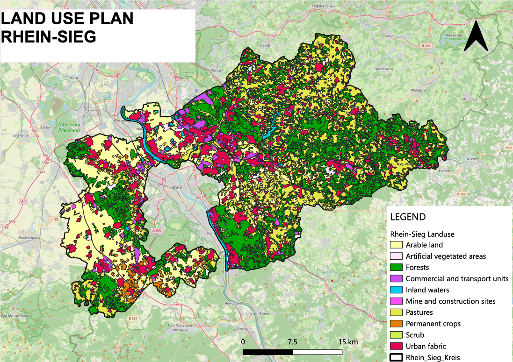
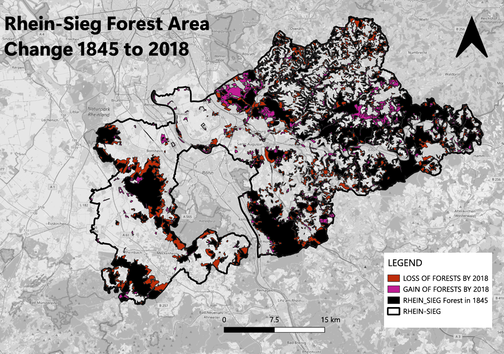
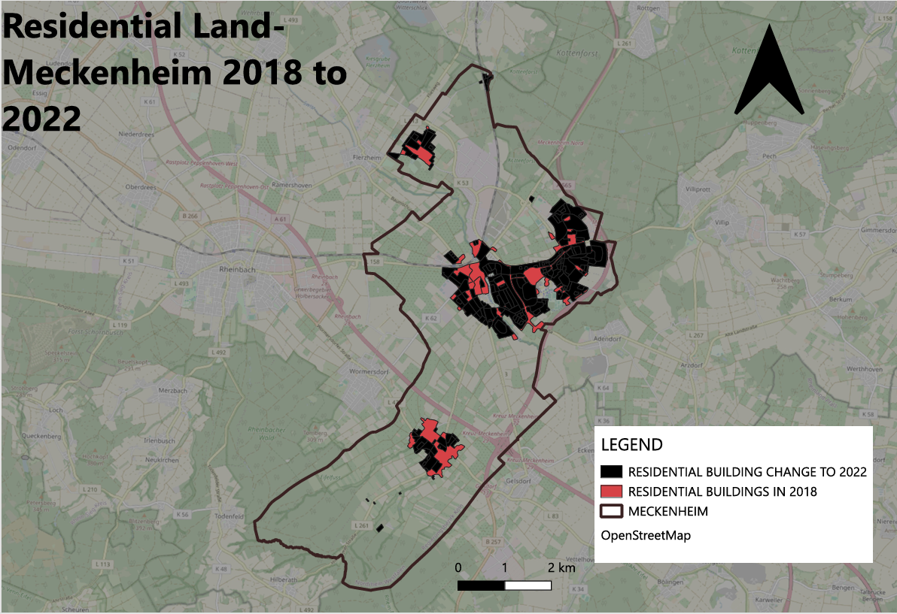
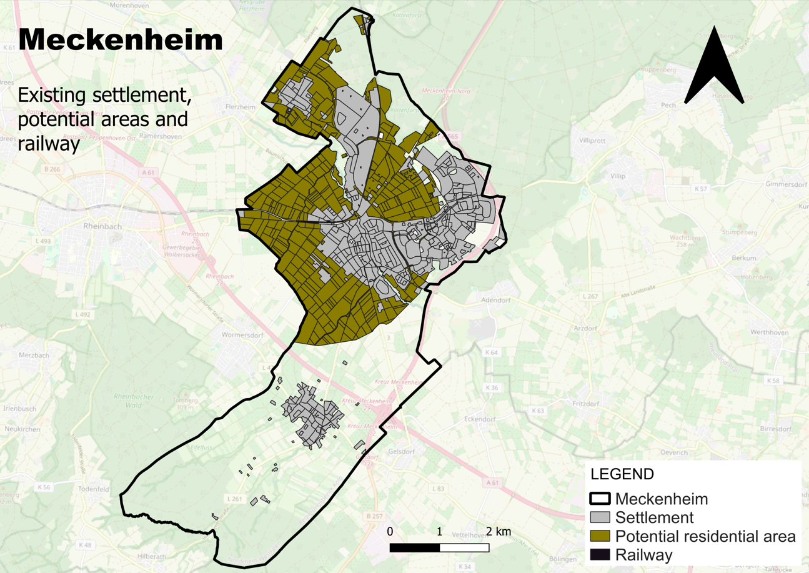
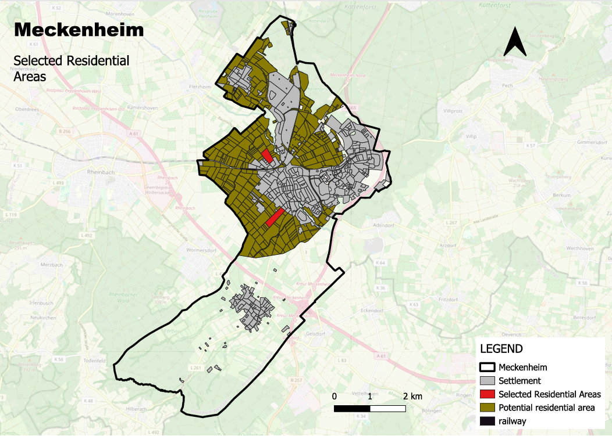

# GIS-Based Land Use, Forest Change, and Multi-Criteria Residential Development Suitability Analysis

**Study Area:** Rhein-Sieg District and Meckenheim, Germany  
**Focus:** GIS · Spatial Analysis · Land-Use Planning · Multi-Criteria Analysis (MCA)

## Overview

This project applies Geographic Information Systems (GIS) to investigate land-use patterns, historical forest change, residential building land change, and potential locations for future residential development in the Rhein-Sieg District and Meckenheim, North Rhine-Westphalia, Germany.

The project combines spatial mapping and change analysis with a **multi-criteria analysis (MCA)** to identify potential residential development locations based on environmental constraints and accessibility to essential services and public transport.

## Project Highlights

- **Land-use mapping:** Visualisation of land-use and land-cover patterns across the Rhein-Sieg District.
- **Forest change analysis:** Assessment of forest-area change between 1845 and 2018.
- **Residential change analysis:** Examination of residential building land change in Meckenheim between 2018 and 2022.
- **Multi-criteria suitability analysis:** Identification of two potential residential development locations in Meckenheim.

## Map Gallery

### 1. Land-Use Plan — Rhein-Sieg District

Visualisation of the spatial distribution of land-use and land-cover categories across the Rhein-Sieg District.

### 2. Forest-Area Change — Rhein-Sieg District, 1845–2018

Historical comparison of forest areas to examine long-term changes in forest distribution and landscape patterns.

### 3. Residential Building Land Change — Meckenheim, 2018–2022

Spatial analysis of changes in residential building land in Meckenheim between 2018 and 2022, illustrating patterns of residential development over the study period.

### 4. Multi-Criteria Residential Development Suitability — Site 1, Meckenheim

The first potential location identified by combining environmental constraints, land-use exclusions, and accessibility criteria. The result highlights an area for further investigation for possible residential development.

### 5. Multi-Criteria Residential Development Suitability — Site 2, Meckenheim

The second potential location identified through the suitability assessment. Together, the two candidate locations demonstrate how GIS-based multi-criteria analysis can support preliminary land-use planning.

## Methodology

### Land-Use and Forest Change

Land-use and land-cover data were used to map the Rhein-Sieg District. Historical forest datasets were compared to examine forest-area change between 1845 and 2018.

Residential building land datasets for 2018 and 2022 were analysed to investigate changes in Meckenheim's residential landscape.

### Multi-Criteria Residential Development Suitability

A GIS-based multi-criteria analysis was used to screen potential residential development locations in Meckenheim. The assessment considered:

| Criterion | Applied requirement |
|---|---|
| Environmental protection | Exclude protected areas and forests |
| Existing land use | Exclude existing settlements and traffic areas |
| Industrial separation | 500 m buffer around industrial areas |
| Railway accessibility | Within 40 minutes by e-bike |
| Kindergarten accessibility | Within 15 minutes on foot |
| Supermarket accessibility | Within 15 minutes by car |
| Residential proximity | Within 100 m of existing residential areas |

Two potential locations were identified based on the specified criteria.

## Data and GIS Techniques

**Data inputs**
- CORINE Land Cover (CLC5, 2018)
- Historical forest-area datasets (1845 and 2018)
- Residential building land datasets (2018 and 2022)
- OpenStreetMap data for transport networks and essential services
- Spatial data representing land-use and environmental constraints

**GIS techniques**
- Land-use and land-cover mapping
- Historical change analysis
- Spatial buffering and proximity analysis
- Network-based accessibility analysis
- Multi-criteria suitability modelling

## Key Outputs

- Land-use map of the Rhein-Sieg District
- Forest-area change map for 1845–2018
- Residential building land change map for Meckenheim, 2018–2022
- Two potential residential development locations identified through multi-criteria analysis

## Limitations

The findings depend on the quality and temporal consistency of the available spatial datasets, as well as the criteria and thresholds selected for the suitability model. Accessibility estimates are influenced by network data and travel-time assumptions.

The two identified locations should be interpreted as **potentially suitable under the criteria applied**, not as officially approved development sites. Further assessment of planning regulations, land ownership, environmental conditions, infrastructure capacity, and site-specific constraints would be necessary before implementation.

## Conclusion

This project demonstrates the application of GIS to regional land-use mapping, historical forest change, residential development analysis, and multi-criteria suitability modelling. By integrating environmental constraints and accessibility requirements, it illustrates how spatial analysis can help identify and evaluate potential areas for future residential development.

---
 
**Specialisation:** GIS, Spatial Analysis, Urban Analytics, and Land-Use Planning
